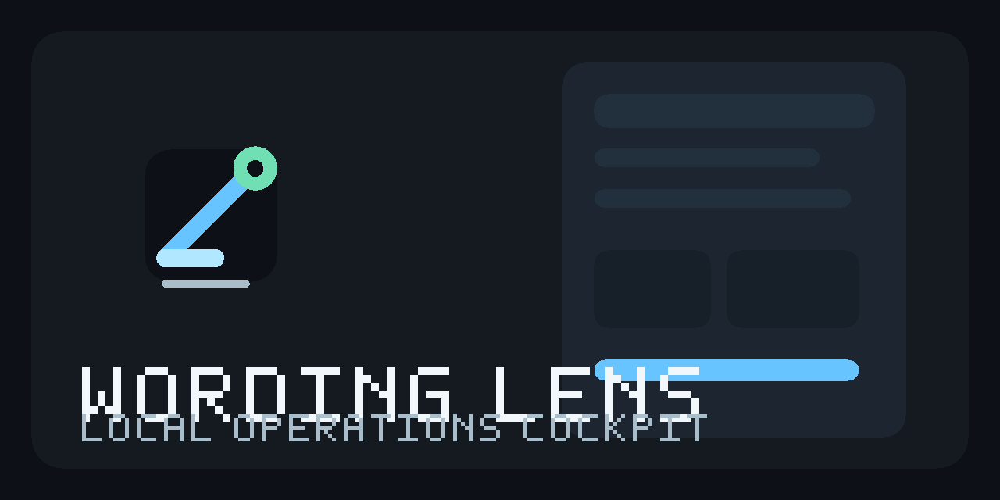

# Wording Lens

Wording Lens is a local-first Windows operations cockpit for projects, tasks,
files, builds, releases, local services, and external tools. It can apply a
user-supplied wording overlay inside the private interface without embedding or
publishing that user's vocabulary.



> The local desktop build and documentation site build are working. The first
> verified installer, deployed site, and public release are still pending.

## Project links

- Documentation site: pending the first verified deployment
- Releases: pending the first verified Windows package
- Roadmap: [ROADMAP.md](ROADMAP.md)
- Handoff: [HANDOFF.md](HANDOFF.md)

## Build

The supported one-command source build is:

```powershell
.\build.bat --run
```

The script bootstraps its pinned toolchain, refuses an uncommitted source state,
builds the real application, verifies the executable and resources, and launches
only after those checks pass. Use `build.bat /s` for non-interactive automation.

Run the complete local check set with:

```powershell
npm test
```

The foundation aggregate recorded 92 passing checks. Current local results and
known baseline failures are recorded in [HANDOFF.md](HANDOFF.md). Local checks
are separate from packaged-application and release evidence.

For the documentation site's project-Pages build and staging commands, see
[Pages publication](docs/features/release/pages-publication.md). Publication
remains pending until the exact deployment and served assets are verified.

The installer path is:

```powershell
.\build-installer.bat /s
```

It produces an unsigned Squirrel.Windows package. That path has not yet completed
its first verified run, so no installer is advertised here.

## Privacy boundary

The repository contains a neutral schema and loader only. It does not contain a
real personal vocabulary, mappings, examples derived from a private file,
private infrastructure, or private captures. A selected vocabulary file is
validated and processed locally. Clearing it restores the shipped wording.

## Shared engineering contract

This project follows the sanitized shared engineering contract in [AGENTS.md](AGENTS.md).
That copy is informational; canonical instruction changes are maintained outside
this public repository.
